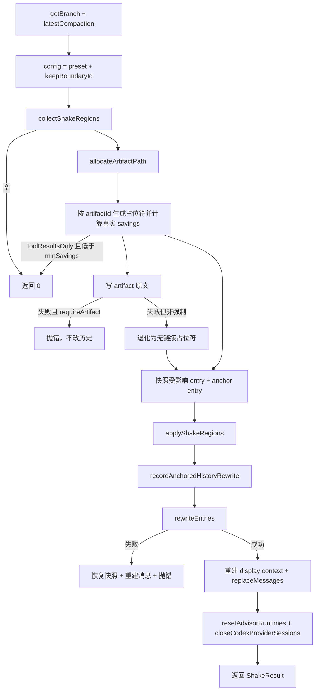

# omp `shake` 功能实现分析

> 分析对象：`omp v18.12.2`（`@oh-my-pi/pi-coding-agent`）。
> 本机源码路径：
> - `$OMP = /home/joshua/.bun/install/global/node_modules/@oh-my-pi/pi-coding-agent`
> - `$CORE = /home/joshua/.bun/install/global/node_modules/@oh-my-pi/pi-agent-core`
>
> 本地 `~/Workspace/Code/JavaScript/pi` checkout 版本为 `0.84.2`，源码中还没有 `shake`，因此本报告全部以已安装包 `18.12.2` 为准。行号对应该版本。

---

## 1. 结论速览

`shake` 是 omp 的“原地结构裁剪”型上下文缩减器：不调用 LLM，直接改写当前会话分支里的重内容，把可恢复内容替换为短占位符，并把原文落到会话 artifact。

它有三档模式：

| 模式 | 做什么 | 是否可恢复 |
|---|---|---|
| `elide`（默认） | 整条工具结果文本、较大的 fenced code / 顶层 XML 块替换为占位符 | 是，artifact 保存原文 |
| `images` | 删除所有 image content block | 否 |
| `thinking` | 删除 assistant 的 `thinking` / `redactedThinking` block | 否 |

实现分为两层：

- **纯逻辑层**：`$CORE/src/compaction/shake.ts`，只负责“找区域 + 原地改写”，不做 I/O。
- **编排层**：`$OMP/src/session/session-maintenance.ts`，负责选择策略、生成占位符、写 artifact、持久化、重建运行态、释放 provider 缓存。

调用面有四类：

1. 用户命令 `/shake [elide|images|thinking]`。
2. 自动 compaction 的一种方法（`compaction.methodOrder` 中的 `shake`）。
3. compaction 死局救援（summarizer 无法切分时，先 elide，再删图）。
4. 特定 Responses `request body read timeout` 的一次性恢复。

---

## 2. 对外接口与调用面

### 2.1 类型与摘要

`ShakeMode` / `ShakeResult` 定义在独立叶子模块 `$OMP/src/session/shake-types.ts`，目的是让 slash command 注册表不必 import 沉重的 `agent-session` 图，避免循环依赖。

```ts
// shake-types.ts:9
export type ShakeMode = "elide" | "images" | "thinking";

// shake-types.ts:12
export interface ShakeResult {
  mode: ShakeMode;
  toolResultsDropped: number;   // 整条 tool result 被替换的数量
  blocksDropped: number;        // fenced/XML 块被替换的数量
  imagesDropped?: number;       // 仅 images
  thinkingBlocksDropped?: number; // 仅 thinking
  tokensFreed: number;          // 估算释放的 token
  artifactId?: string;          // 原文落盘的 artifact id
}
```

`formatShakeSummary()` 是 TUI 与 headless/ACP 共用的单行摘要（`shake-types.ts:29`）：

- `images`：`Dropped N image(s) from this session.` / `No images found in this session.`
- `thinking`：`Dropped N thinking block(s) ... (~M tokens freed).`
- `elide`：`Shook N tool results + M blocks (~K tokens freed).` / `Nothing to shake.`

### 2.2 `/shake`

slash command 注册在 `$OMP/src/slash-commands/builtin-lifecycle.ts:277`。

```ts
name: "shake",
icon: "vibrate",
description: "Drop heavy content from context (tool results, large blocks)",
subcommands: [
  { name: "elide", description: "Strip tool results + large blocks (default)" },
  { name: "images", description: "Strip image blocks" },
  { name: "thinking", description: "Drop all thinking blocks" },
]
```

参数解析在 `builtin-lifecycle.ts:50`：

```ts
function parseShakeMode(args: string): ShakeMode | { error: string } {
  const verb = args.trim().toLowerCase();
  if (verb === "" || verb === "elide") return "elide";
  if (verb === "images") return "images";
  if (verb === "thinking") return "thinking";
  return { error: `Unknown /shake mode "${verb}". Use elide, images, or thinking.` };
}
```

两个执行分支：

- headless/ACP：直接 `runtime.session.shake(mode)`，然后 `runtime.output(formatShakeSummary(result))`。
- TUI：`handleShakeCommand(mode)`，执行后 `rebuildChatFromMessages()`、`statusLine.invalidate()`、`requestRender({ clearScrollback: true })`，再显示摘要（`$OMP/src/modes/controllers/command-controller.ts:2012`）。

`/shake` 没有走 compaction 的 abort/继续链路，也不会生成 `CompactionResult`；它只是改写当前分支并重建聊天视图。

### 2.3 自动 compaction 方法

`$OMP/src/session/compaction-methods.ts:44` 的默认顺序：

```ts
["remote", "snapcompact", "handoff", "shake", "soft"]
```

- `remote`：provider 原生 compaction。
- `snapcompact`：把历史渲染成 bitmap 图片给视觉模型读，需要模型支持 image input。
- `handoff`：生成 handoff 文档后原地继续，`overflow` 场景不可用。
- `shake`：本地、无 LLM 的结构裁剪。
- `soft`：普通摘要 compaction。

`isCompactionMethodUsable()`（`session-maintenance.ts:188`）对 `shake` 始终返回 `true`；因此只要配置里包含 `shake`，它在自动链路里总是可被选中。

### 2.4 其他入口

| 入口 | 代码位置 | 作用 |
|---|---|---|
| `AgentSession.shake()` | `$OMP/src/session/agent-session.ts:6799` | 对 `SessionMaintenance.shake` 的薄封装 |
| 自动 compaction | `session-maintenance.ts:4680` 起 | 按 `methodOrder` 选择方法；选中 `shake` 时转 `#runAutoShake` |
| compaction 死局救援 | `session-maintenance.ts:4205` | 先 `RESCUE_SHAKE_CONFIG` elide，再 `dropImages` |
| Responses body-read timeout | `session-maintenance.ts:1077`、`turn-recovery.ts:1470` | 只 elide tool result，且强制 artifact 可恢复 |

---

## 3. 数据模型

### 3.1 `ShakeConfig`

`$CORE/src/compaction/shake.ts:28`：

```ts
export interface ShakeConfig {
  protectTokens: number;        // 最近多少 token 保持不动
  minSavings: number;           // 估算净节省低于该值则不执行
  protectedTools: ProtectedToolMatcher[]; // 字符串按 toolName 匹配，函数可检查配对 tool call
  fenceMinTokens: number;       // fenced/XML 块的最小可裁剪 token 数
  keepBoundaryId?: string;      // 最新 compaction 的 firstKeptEntryId，之前的 entry 跳过
}
```

三个预设（`shake.ts:48/61/69`）：

| 预设 | protectTokens | minSavings | protectedTools | 使用场景 |
|---|---:|---:|---|---|
| `DEFAULT_SHAKE_CONFIG` | 16,000 | 4,000 | `"skill"`, skill read, artifact recovery read | 自动 shake |
| `AGGRESSIVE_SHAKE_CONFIG` | 4,000 | 0 | `"skill"`, skill read | 手动 `/shake` |
| `RESCUE_SHAKE_CONFIG` | 0 | 0 | 同 aggressive + artifact recovery read | compaction 死局救援 |

关键差异：

- 自动模式保留最近 16k token，并要求至少 4k 净节省，避免小打小闹导致每轮重写。
- 手动模式几乎不设防，但保留最近 4k，避免把 agent 当前正在使用的工具结果抽掉（源码注释提到 #7776）。
- 救援模式把保护窗口降到 0，确保最新那条超大结果也能被裁掉；但仍保护 artifact recovery read，避免“删掉恢复读取 → 又生成新 artifact”的循环。

### 3.2 `ShakeRegion`

`shake.ts:82/92/106` 定义两类区域：

```ts
interface ToolResultShakeRegion {
  kind: "toolResult";
  entry: SessionMessageEntry;
  tokens: number;        // 仅可删除文本的 token，保留的图片不计
  originalText: string;
  label: string;         // toolName
}

interface BlockShakeRegion {
  kind: "block";
  entry: SessionMessageEntry | CustomMessageEntry;
  blockIndex: number;    // -1 表示 content 是字符串
  start: number;         // 字符偏移，[start, end)
  end: number;
  tokens: number;
  originalText: string;
  label: string;         // role 或 customType
}
```

---

## 4. `elide` 检测算法（纯逻辑层）

### 4.1 总体流程

`collectShakeRegions()`（`shake.ts:310`）是纯检测函数，输入整个 branch 的 `SessionEntry[]`、tokenizer、config，输出按文档顺序排列的 `ShakeRegion[]`。

```
n = entries.length
accumulatedAfter[i] = 所有 index > i 的 entry token 之和
toolCallsById = 收集 assistant 消息里的 toolCall

boundaryIndex =
  keepBoundaryId === undefined ? 0
  : max(0, entries.findIndex(e => e.id === keepBoundaryId))

for i in 0..n-1:
  if i < boundaryIndex: continue

  toolResult = entry 是 toolResult ? entry.message : undefined
  uselessResult = toolResult?.useless === true && toolResult.isError !== true

  // 最近 protectTokens 内的 entry 默认跳过
  if !uselessResult && accumulatedAfter[i] < protectTokens: continue

  if toolResult:
    if toolResult.prunedAt !== undefined: continue
    if isProtectedToolResult(...): continue
    text = 拼接所有非空 text block
    if !text: continue
    regions.push(toolResult region)
    continue

  if entry 是 message 或 custom_message:
    collectBlockRegions(entry, ...)

savings = Σ max(0, region.tokens - 16)
if savings < minSavings: return []
return regions
```

几个容易忽略的点：

- `accumulatedAfter[i]` 是“该 entry 之后的所有内容”。因此保护的是尾部窗口，而不是单条 entry。
- `useless === true && isError !== true` 的 tool result 可以绕过保护窗口，因为工具自己已经声明它没有信息量；但仍然要过 `prunedAt` 和 `protectedTools`。
- `keepBoundaryId` 之前的 entry 已被最新 compaction 摘要掉，不再发送给模型，裁它们只会白白改写持久化历史。
- 工具结果一旦命中，就直接 `continue`，不会再对它做 fenced/XML 块级扫描。工具结果要么整条替换，要么不动。

### 4.2 工具结果的可裁剪条件

`toolResultText()`（`shake.ts:113`）：

- 收集 `message.content` 中所有 `type === "text"` 且非空的 block。
- 用 `\n` 拼接成 `originalText`。
- `tokens` 只统计这些文本块，图片等非文本内容不计入“可节省 token”。

`applyShakeRegion()` 在替换时会保留所有非文本块（图片等），只把第一个非空 text block 换成占位符，其余 text block 删除，并写入 `prunedAt`。因此 tool call / tool result 的配对关系不会断：assistant 的 `toolCall` block 不动，toolResult 消息本身仍在，只是文本被替换。

### 4.3 fenced code 与顶层 XML 检测

`scanTextForBlockRanges()`（`shake.ts:151`）逐行扫描：

- 行首 `trimStart()` 后以 ``` 或 ~~~ 开头即视为 fence line。
- 进入 fence 后，下一次遇到任意 fence line 就关闭；不要求标记类型或长度匹配。
- 未闭合的 fence 不产生范围。
- 不在 fence 内时，检测 XML：
  - 起始/结束标签必须从行首开始，不能有前导空白（`line.length === trimmedStart.length`）。
  - 只匹配小写标签名：`^<([a-z_-]+)(?:\s+[^>]*)?>$` / `^<\/([a-z_-]+)>$`。
  - 用栈处理嵌套；结束标签必须匹配栈顶；未闭合标签不产生范围。
  - fence 内部的 XML 不检测。
- 范围覆盖整个块（包含开始/结束 fence 或标签行），不包含末尾换行。

`mergeRanges()`（`shake.ts:211`）按 start 升序排序，丢弃与已保留范围重叠的项。因为 fence/XML 范围是正确嵌套的，重叠等价于包含，保留先出现的范围即保留最外层。

这套逻辑刻意与 prompt 渲染的 `format()` 行为对齐，属于“保守检测”：宁可不裁，也不要把半个代码块裁掉。

### 4.4 block 扫描范围

`collectBlockRegions()`（`shake.ts:257`）：

- assistant：只扫描 `type === "text"` 的 block。
- user / developer：扫描 `message.content`（字符串或数组）。
- `custom_message`：扫描 `entry.content`，label 用 `customType`。
- 不扫描 thinking block；thinking 是独立模式。
- 不扫描 tool result；它走整条替换。

每个候选块还要满足 `tokens >= config.fenceMinTokens`（默认 400）。

### 4.5 节省量门槛

检测结束后用固定估算 `PLACEHOLDER_TOKEN_ESTIMATE = 16` 计算净节省：

```
savings = Σ max(0, region.tokens - 16)
```

低于 `minSavings` 直接返回空数组。自动模式因此不会为了几百 token 去重写整段历史。

---

## 5. `elide` 执行与持久化（编排层）

`SessionMaintenance.shake("elide")`（`session-maintenance.ts:895`）的完整流程：



### 5.1 配置与边界

```ts
const config = this.#withPlanProtection({
  ...(opts.config ?? AGGRESSIVE_SHAKE_CONFIG),
  keepBoundaryId: latestCompaction?.firstKeptEntryId,
});
```

- 默认手动调用不传 config，使用 `AGGRESSIVE_SHAKE_CONFIG`。
- 自动与救援会显式传入 `DEFAULT_SHAKE_CONFIG` / `RESCUE_SHAKE_CONFIG`。
- `#withPlanProtection()`（`session-maintenance.ts:696`）额外加入 plan 文件读取保护：如果 `read` 的路径等于当前 plan reference path，则不裁。这样 plan 文件不会在 shake 后消失。
- `keepBoundaryId` 指向最新 compaction 的 `firstKeptEntryId`。

### 5.2 artifact 生成

```ts
const replacements = regions.map((region, index) => this.#shakeElidePlaceholder(region, index, id));
```

占位符（`session-maintenance.ts:1098`）：

```
[shaken ~<tokens> tokens — recover: artifact://<id> (region <n>)]
```

没有 artifact 时：

```
[shaken ~<tokens> tokens]
```

artifact 正文（`session-maintenance.ts:1105`）按 region 分段：

```
### region 1 (<label>, ~<tokens> tok)

<originalText>

### region 2 (...) 
...
```

落盘路径由 `SessionManager.allocateArtifactPath("shake")` 分配（`session-manager.ts:3197`），实际由 `ArtifactManager.allocatePath()` 生成 `${id}.shake.log`；id 是会话内递增的字符串。`writeArtifact()`（`$OMP/src/session/artifacts.ts:44`）先写临时文件，校验字节数与可读性，再原子 rename，失败时删除临时文件，不破坏旧 artifact。

`requireArtifact` 只用于 Responses body-read timeout 恢复：如果 artifact 保存失败，必须在改历史之前抛错，避免产生无法恢复的占位符。

### 5.3 原地应用

`applyShakeRegions()`（`shake.ts:470`）先把所有 block region 按 `start` 降序排序，再逐个调用 `applyShakeRegion()`。原因是同一个 text block 里可能有多个 region；从后往前替换，前面的字符偏移不会被破坏。tool result region 的 `start` 视为 -1，彼此独立。

`applyShakeRegion()`（`shake.ts:431`）：

- tool result：
  - 找到第一个非空 text block。
  - 构造新 content：非文本块全部保留；该位置替换为占位符；其他 text block 删除。
  - `message.prunedAt = Date.now()`。
  - `invalidateMessageCache(message)`。
- block：
  - 通过 `getBlockTextSlot()` 拿到 `read`/`write` 闭包，对字符串或 `text` block 做 splice。
  - 如果 entry 是普通 `message` 且 role 是 assistant，累加 `message.elidedOutputTokens += max(0, region.tokens - replacementTokens)`。
  - `invalidateMessageCache(message)`。

`elidedOutputTokens` 的作用：assistant 的 `usage.output` 仍然按原始输出计费，后续 `countMessage` 会把被裁掉的文本从 output 估算里扣掉（`$CORE/src/tokenizer.ts:504`）。

### 5.4 计数与上下文锚点

执行时统计：

- `toolResultsDropped`：toolResult region 数。
- `blocksDropped`：block region 数。
- `originalTokens`：所有 region 的 `tokens` 之和。
- `replacementTokens`：所有占位符的实际 token 数之和。
- `tokensFreed = max(0, originalTokens - replacementTokens)`。

同时计算 `anchoredTokensRemoved`。源码条件等价于：

```
entryIndex < anchorIndex
  && (!hasRemoteReplacementHistory || entryIndex > compactionIndex)
```

也就是说，只统计最新 transcript usage anchor 之前省下的 token；如果最新 compaction 是 OpenAI remote compaction 的 replacement history，还要求 entry 位于 compaction cutoff 之后，因为 remote replacement 会隐藏 cutoff 之前的全部内容。这里的 `anchorIndex` 由 `findUsageAnchorIndex()` 从 branch 末尾向 compaction 之后搜索，找不到则为 -1（此时不记 anchored savings）。

`recordAnchoredHistoryRewrite()`（`session-stats.ts:437`）把这些节省写到最新 assistant 的 `contextSnapshot.historyRewriteTokensRemoved`。之后 `correctedPromptTokens()`（`session-stats.ts:56`）计算上下文占用时会从 provider 报告的 prompt token 中减去它，避免上下文百分比在下次真实响应前虚高。

这是“估算节省”和“provider 计费”之间的桥：`ShakeResult.tokensFreed` 是估算值，真正修正 context meter 的是 anchor 修正。

### 5.5 持久化与运行态重建

成功路径：

```ts
this.#host.recordAnchoredHistoryRewrite(anchoredTokensRemoved);
await this.#host.sessionManager.rewriteEntries(); // 原子重写 session 文件

const sessionContext = this.#host.buildDisplaySessionContext();
this.#host.agent.replaceMessages(sessionContext.messages);

this.#host.resetAdvisorRuntimes("shake");
this.#host.closeCodexProviderSessionsForHistoryRewrite();
```

- `rewriteEntries()`（`session-manager.ts:3601`）先增加 body revision，再原子重写；非持久会话直接返回。
- `buildDisplaySessionContext()` 从被改写的 branch 重新投影消息。
- `agent.replaceMessages()` 让运行中的 agent 立刻看到新历史。
- `resetAdvisorRuntimes("shake")`：advisor 的上下文前缀已失效，全部重建。
- `closeCodexProviderSessionsForHistoryRewrite()`：Codex Responses 等 provider 会缓存消息 identity，必须关闭 session 强制下一次完整重放。

失败回滚：

- 在应用之前，对每个受影响的 entry 和 anchor entry 做 `structuredClone` 快照。
- 如果 `rewriteEntries()` 抛错，用 `Object.assign(entry, snapshot)` 恢复，再重建一次 display context，然后重新抛错。
- 这样不会出现“内存里已裁剪、磁盘上没裁剪”的分叉。

取消：

- `assertCurrent()` 在选区域后、artifact 分配后、写 artifact 后、应用前检查 `opts.signal?.aborted` 与 `opts.isCurrent?.() === false`。
- 任一条件成立抛 `CompactionCancelledError`。
- `thinking` / `images` 路径没有这套检查。

---

## 6. `images` 模式

`shake("images")` 不做 elide，直接委托 `dropImages()`（`session-maintenance.ts:815`）。

行为：

- 遍历整个 branch 的所有 entry，包括 `message` 和 `custom_message`。
- 普通消息：调用 `stripImagesFromMessage()` 删除 image block。
- `custom_message`：手动过滤 `type === "image"`；如果过滤后 content 为空，插入 `{ type: "text", text: "[image removed]" }`。
- 用 `excludeEncryptedReasoning: true` 的计数方式测量前后 token 差。
- 与 elide 一样计算 anchored savings 并调用 `recordAnchoredHistoryRewrite`。
- 持久化、重建消息、`resetAdvisorRuntimes("drop-images")`、关闭 Codex provider session。

与 elide 的差异：

- 没有 artifact，图片不可恢复。
- 不受 `protectTokens`、`protectedTools`、`fenceMinTokens` 限制；它删除所有图片。
- 不检查 compaction boundary；摘要掉的旧 entry 里的图片也会被删。

使用场景在源码中很明确：provider 的 image count / media budget 拒绝、assistant 空 stop 重试耗尽后建议 `/shake images` 清掉归档帧（`turn-recovery.ts:1069`）。图片计数限制无法靠 token compaction 解决，所以单独提供该模式。

---

## 7. `thinking` 模式

`shake("thinking")`（`session-maintenance.ts:913`）直接遍历整个 branch：

```ts
for (const [index, entry] of branchEntries.entries()) {
  if (entry.type !== "message" || entry.message.role !== "assistant") continue;
  const kept = message.content.filter(
    block => block.type !== "thinking" && block.type !== "redactedThinking",
  );
  if (kept.length === message.content.length) continue;

  const before = tokenizer.countMessage(message, { excludeEncryptedReasoning: true });
  message.content = kept;
  invalidateMessageCache(message);
  const saved = max(0, before - tokenizer.countMessage(message, { excludeEncryptedReasoning: true }));
  ...
}
```

特点：

- 删除 `thinking` 与 `redactedThinking`，不插入占位符。
- 不生成 artifact，不可恢复。
- 没有 `protectTokens` 保护窗口；最近与最旧的 thinking 都会删。
- 不检查 `keepBoundaryId`；被 compaction 摘要掉的旧 entry 也会被改写。
- 计数时排除 encrypted reasoning bytes，避免把不可换算的加密推理算进 token 节省。
- 与 elide 一样计算 anchored savings、`rewriteEntries`、重建消息、重置 advisor、关闭 Codex provider session。

这个模式主要用于“历史里残留的 thinking 导致 provider 拒绝或模型行为异常”的清理场景；它不追求可恢复性。

---

## 8. 自动化集成

### 8.1 `runAutoCompaction` 的方法选择

`runAutoCompaction()`（`session-maintenance.ts:4680`）：

1. 若 `compaction.enabled === false` 且不是显式 `new_context`，直接返回。
2. `methods = resolveCompactionMethodOrder(settings.methodOrder)`。
3. 从 `options.methodIndex ?? 0` 开始遍历，跳过 `isCompactionMethodUsable()` 为 false 的方法。
4. 选中 `shake` 且没有已武装的 speculative summary 时，调用 `#runAutoShake()`。
5. `#runAutoShake()` 返回 `"fallback"` 时，递归调用 `runAutoCompaction()`，`methodIndex + 1`，并设置 `fallbackFromShake: true`。

`shake` 在 `isCompactionMethodUsable()` 中恒为 true，所以它不会因为模型能力被跳过；能否真正回收 token 由运行时判断。

### 8.2 `#runAutoShake` 的判定

`#runAutoShake()`（`session-maintenance.ts:5833`）：

```ts
const action = "shake";
this.#autoCompactionAbortController?.abort();
const controller = new AbortController();
const signal = controller.signal;

await emit({ type: "auto_compaction_start", reason, action }, false);
const result = await this.#host.shake("elide", { config: DEFAULT_SHAKE_CONFIG, signal });
```

- 使用 `DEFAULT_SHAKE_CONFIG`，即保护最近 16k、要求至少 4k 净节省。
- `reclaimed = toolResultsDropped + blocksDropped > 0`。
- 若 aborted：发 `auto_compaction_end` with `aborted: true`，返回 none。

是否 fallback 到下一个方法：

```ts
const shouldFallBack =
  reason !== "idle" &&
  ((reason === "overflow" && !reclaimed) || stillOverThreshold);
```

`stillOverThreshold` 的计算分两条路径：

1. 调用方给了 `triggerContextTokens`：
   - `correctedTokens = max(0, triggerContextTokens - result.tokensFreed)`。
   - `recoveryBand = floor(thresholdTokens * 0.8)`。
   - `stillOverThreshold = correctedTokens > recoveryBand`。
2. 没有 `triggerContextTokens`：
   - `postShakeTokens = getContextUsage({ contextWindow }).tokens`。
   - `stillOverThreshold = shouldCompact(postShakeTokens, contextWindow, settings)`。

注意：注释声称两条路径都使用 80% recovery band，但代码里只有第一条显式使用 band；第二条仍用原始阈值。见第 10 节。

`reason === "idle"` 永远不 fallback：空闲定时器会在 60s+ 后重新检查 usage，不会形成紧循环。

fallback 时发：

```
auto_compaction_end {
  action: "shake",
  result: undefined,
  aborted: false,
  willRetry: false,
  skipped: !reclaimed,
  errorMessage: reclaimed
    ? "Auto-shake reclaimed ~N tokens but context is still above the threshold; ..."
    : "Auto-shake found nothing eligible to drop; ..."
}
```

成功时发 `skipped: !reclaimed`，然后调度继续：

- `willRetry`（通常是 overflow 重试）：
  - 如果最后一条 assistant 是 `error`，或 `reason === "incomplete"` 且 stopReason 是 `length`，先 `replaceMessages(messages.slice(0, -1))` 去掉失败尾。
  - `scheduleAgentContinue({ source: "shake-retry", delayMs: 100, generation })`。
- 否则：`scheduleCompactionContinuation(...)`。

返回值：

- 有回收：`historyRewritten: true`。
- 无回收但 `willRetry` 且调度了继续：也标记 `historyRewritten: true`（因为失败尾被移除本身也是历史改写）。
- 其余按是否调度继续返回。

异常：

- aborted：发 aborted end，返回 none。
- 其他异常：发 `auto_compaction_end` with `errorMessage`；`reason === "overflow"` 时仍返回 `"fallback"`，否则 none。

### 8.3 死局救援

`#rescueCompactionDeadEnd()`（`session-maintenance.ts:4205`）处理“summarizer 无法切分”的情况：最新的超大 tool result / fenced block / 图片使 `prepareCompaction()` 找不到可摘要的旧历史。

分 tier：

1. **Tier 0**：snapcompact 的 frame archive 本身超预算时，按阈值重建 frame 预算。
2. **Tier 1**：`shake("elide", { config: RESCUE_SHAKE_CONFIG, signal })`。
   - `RESCUE_SHAKE_CONFIG` 的 `protectTokens: 0`，能裁最新结果。
   - 成功后 `rebaseAfterCompaction()`，让正在进行的上下文快照重新锚定。
   - 如果 `fallbackFromShake` 为 true（说明自动链路已经跑过 shake 且没成功），跳过 Tier 1，避免重复。
3. **Tier 2**：`dropImages()`。只有 elide 未能恢复进度后才执行；图片不可恢复。

救援成功后发一条 info notice，说明释放了多少内容。

### 8.4 Responses body-read timeout

`shakeForRequestBodyReadTimeout()`（`session-maintenance.ts:1077`）：

```ts
const settings = this.#compactionSettings;
if (!settings.enabled || !resolveCompactionMethodOrder(settings.methodOrder).includes("shake")) {
  return false;
}
const isCurrent = () => !isDisposed() && promptGeneration() === generation;
if (!isCurrent()) return false;

const result = await this.shake("elide", {
  config: DEFAULT_SHAKE_CONFIG,
  requireArtifact: true,
  isCurrent,
  toolResultsOnly: true,
});
return isCurrent() && result.toolResultsDropped + result.blocksDropped > 0;
```

调用点是 `turn-recovery.ts:1470` 的 `handleResponsesRequestBodyReadTimeout()`：

- 只处理 `stopReason === "error"` 且错误被识别为 Responses request-body-read timeout 的消息。
- 如果 retry 关闭、重试次数耗尽、正在 compacting、输出不可安全重放，直接 terminal。
- 否则调用 shake；成功则走一次 `#handleRetryableError()`，且 `allowModelFallback: false`。
- 失败则 terminal；terminal 内部只有在 `!replayUnsafe`（输出可安全重放）时才把该 assistant 消息从活动上下文移除，`replayUnsafe` 时保留。

`toolResultsOnly: true` 的意义：只裁 tool result，不碰用户/助手的 fenced block；并且会在实际 placeholder 计算后再检查一次 `minSavings`，避免 artifact id 让占位符变长导致净节省不足。

---

## 9. UI 与事件

自动 compaction 的 `auto_compaction_start` / `auto_compaction_end` 事件带 `action: "shake"`（`$OMP/src/session/agent-session-events.ts:35`）。

TUI `event-controller.ts`：

- start：显示 `Auto-shake…` loader，计入 maintenance 进度。
- end：
  - aborted → `Auto-shake cancelled`。
  - `errorMessage` 且 `!skipped` → 先 rebuild chat（因为 shake 已经改写了历史），再显示 warning。
  - 成功且 `!skipped` → `lastAssistantUsage = undefined`，rebuild chat，invalidate status line，`requestRender({ clearScrollback: true })`，显示 `Auto-shake completed`。
  - `skipped` → 不重建，避免无意义闪烁。

手动 `/shake` 的 TUI 路径与自动路径类似：先判断 `dropped === 0`，是则 `Nothing to shake.`；否则重建聊天、清 scrollback、显示摘要。

---

## 10. 设计取舍与风险观察

以下前 6 条直接来自源码行为；后几条是分析判断，已标注。

### 10.1 shake 是 compaction 级操作，不是 prune

`prune`（`$CORE/src/compaction/pruning.ts`）有针对 prompt cache 的 warm suffix 限制，只裁已经冷却或可安全改写的部分。`shake` 的注释明确说它是 compaction-class reducer，会改写包括 warm cached prefix 在内的历史。这说明 shake 的定位是“在 compaction 时机做大扫除”，而不是每轮都跑的廉价优化。自动链路把它放在 `remote` / `snapcompact` / `handoff` 之后，也符合这个定位。

### 10.2 手动模式会裁掉 artifact recovery read

`AGGRESSIVE_SHAKE_CONFIG.protectedTools` 只有 `"skill"` 和 skill read，不包含 `isArtifactRecoveryToolResult`。因此连续手动 `/shake elide` 可能把上一次 shake 生成的 `artifact://` 恢复读取也裁掉。源码注释把这称为 “the user's full escape hatch”，属于有意为之；默认自动与救援模式则保护 recovery read，避免循环。

### 10.3 thinking / images 不做边界检查与回滚

`elide` 会跳过 `keepBoundaryId` 之前的 entry，并在 `rewriteEntries()` 失败时恢复快照。`thinking` 和 `images` 则是全 branch 遍历：

- 被 compaction 摘要掉的旧 entry 也会被改写；
- 没有 `structuredClone` 快照，`rewriteEntries()` 失败时内存中的 block 已经变了；
- 没有 `signal` / `isCurrent` 取消检查。

这不一定是 bug（这两种模式本来就是“全量清理”，且失败时进程通常会终止），但它是实现上的明显不对称。[INFERENCE] 如果未来要支持“取消 thinking 清理”或“失败恢复”，这两条路径需要补齐与 elide 相同的事务边界。

### 10.4 自动 fallback 的 recovery band 只在一条路径生效

`#runAutoShake` 上方注释说 post-shake 检查使用 `COMPACTION_RECOVERY_BAND × threshold`，避免在阈值附近来回震荡（#2275）。实际代码：

- 有 `triggerContextTokens`：使用 `floor(threshold * 0.8)`。
- 没有 `triggerContextTokens`：使用 `shouldCompact(postShakeTokens, ...)`，即原始阈值，没有 band。

因此“本地估算路径”仍可能在阈值边缘反复触发。判断：这更像是遗漏而非设计，但影响取决于调用方是否总是传 `triggerContextTokens`。自动 threshold 检查通常会传，idle/部分恢复路径可能不传。

### 10.5 `"skill"` 字符串保护是粗粒度的

`protectedTools` 里的字符串按 `toolResult.toolName === matcher` 匹配。`"skill"` 会保护所有名为 `skill` 的工具结果，不管它读取的是不是一个 skill 路径。函数 matcher `isSkillReadToolResult` 则精确检查 `read` 工具 + `skill://` 前缀。两者同时存在，说明字符串是“按工具整体保护”的保守兜底，函数是精确保护。

### 10.6 工具结果是整条替换，不是截断

`applyShakeRegion()` 把第一个非空 text block 整体替换为占位符，并删除其余 text block。它不会保留输出的头部/尾部，也不会做“保留最近 N 行”的截断。对于需要保留部分上下文的场景，这比 transcript 截断更激进；优点是实现简单、节省确定、恢复路径统一走 artifact。

### 10.7 fenced/XML 检测是保守启发式

- 只识别小写标签名。
- XML 标签必须在行首，不能缩进。
- fence 只要求行首是 ``` 或 ~~~，不要求闭合标记匹配。
- 未闭合的 fence/tag 不会被裁剪。
- XML 检测在 fence 内关闭。

这会产生 false negative（该裁的没裁），但很少产生 false positive（裁掉不该裁的）。对上下文安全来说这是正确的偏置。

### 10.8 占位符 token 估算与实际值有偏差

检测阶段用固定 16 token 估算占位符，实际占位符包含 artifact id 和 region 序号，长度会变。一般路径在检测阶段已经通过 `minSavings`，不会再按实际值重新卡；只有 `toolResultsOnly` 路径会在 artifact 分配后重新计算并再次检查。影响很小，但意味着“估算节省”和“实际节省”可能略有出入。

### 10.9 没有语义压缩

`shake` 只做结构删除，不理解内容重要性（除了工具级保护、skill/plan/recovery 保护、useless 标记）。真正需要语义摘要时要用 `soft` / `handoff` / `remote` / `snapcompact`。这也是它作为 fallback 链中“便宜、快速、可恢复”一环的定位。

---

## 11. 源码索引

| 文件 | 关键位置 | 作用 |
|---|---|---|
| `$CORE/src/compaction/shake.ts` | 28 | `ShakeConfig` |
|  | 48 / 61 / 69 | `DEFAULT` / `AGGRESSIVE` / `RESCUE` 预设 |
|  | 82 / 92 / 106 | `ToolResultShakeRegion` / `BlockShakeRegion` / `ShakeRegion` |
|  | 113 | `toolResultText()` |
|  | 129 | `entryTokens()` |
|  | 151 | `scanTextForBlockRanges()` |
|  | 211 | `mergeRanges()` |
|  | 224 | `pushBlockRegions()` |
|  | 257 | `collectBlockRegions()` |
|  | 310 | `collectShakeRegions()` |
|  | 431 | `applyShakeRegion()` |
|  | 470 | `applyShakeRegions()` |
| `$CORE/src/compaction/tool-protection.ts` | 15 | `collectToolCallsById()` |
|  | 34 | `getToolResultMessage()` |
|  | 46 | `getReadToolPath()` |
|  | 52 | `isSkillReadToolResult()` |
|  | 59 | `isArtifactRecoveryToolResult()` |
|  | 66 | `isProtectedToolResult()` |
| `$OMP/src/session/shake-types.ts` | 9 / 12 / 29 | `ShakeMode` / `ShakeResult` / `formatShakeSummary()` |
| `$OMP/src/session/session-maintenance.ts` | 188 | `isCompactionMethodUsable()` |
|  | 259 | `findUsageAnchorIndex()` |
|  | 696 | `#withPlanProtection()` |
|  | 815 | `dropImages()` |
|  | 895 | `shake()` |
|  | 1077 | `shakeForRequestBodyReadTimeout()` |
|  | 1098 / 1105 / 1115 | 占位符 / artifact 正文 / artifact 保存 |
|  | 4205 | `#rescueCompactionDeadEnd()` |
|  | 4680 | `runAutoCompaction()` |
|  | 5833 | `#runAutoShake()` |
| `$OMP/src/session/agent-session.ts` | 6799 | `AgentSession.shake()` 门面 |
| `$OMP/src/session/compaction-methods.ts` | 44 / 79 | 默认方法顺序 / 方法到 engine strategy 的映射 |
| `$OMP/src/config/settings.ts` | 2798 | legacy `compaction.strategy` → `methodOrder` 兼容 |
| `$OMP/src/slash-commands/builtin-lifecycle.ts` | 50 / 277 | `/shake` 参数解析与命令注册 |
| `$OMP/src/modes/controllers/command-controller.ts` | 2012 | TUI `handleShakeCommand()` |
| `$OMP/src/modes/controllers/event-controller.ts` | 2540 | 自动 shake 的 TUI 状态处理 |
| `$OMP/src/session/session-stats.ts` | 56 / 437 | `correctedPromptTokens()` / `recordAnchoredHistoryRewrite()` |
| `$OMP/src/session/turn-recovery.ts` | 1470 / 1495 | Responses body-read timeout 恢复 |
| `$OMP/src/session/session-manager.ts` | 3197 / 3202 / 3601 | artifact 分配 / 保存 / `rewriteEntries()` |
| `$OMP/src/session/artifacts.ts` | 44 / 157 / 171 | 原子写 artifact / 分配路径 / 保存 |
| `$OMP/src/session/agent-session-events.ts` | 35 | `auto_compaction_start/end` 的 `action` 类型 |

---

## 12. 对本项目的可复用结论

`transcript_shaker` 的职责是“把 transcript 转成精炼文档”，不是上下文压缩，因此不能直接复用 shake 的改写逻辑；但它的几个设计点值得借鉴：

1. **原文落 artifact + 占位符**：任何“删除”都保留恢复入口，比不可逆截断更适合审计型 transcript。
2. **保护窗口按尾部 token 计算**：比“最近 N 条消息”更稳定，不受单条超大消息影响。
3. **纯检测 / 纯应用分层**：`collectShakeRegions()` 不写盘，`applyShakeRegions()` 只做 splice，编排层负责 I/O 与持久化。这与本项目“脚本负责确定性转换、Agent 负责识别”的边界一致。
4. **保护名单按“工具 + 参数”匹配**：skill read、plan read、artifact recovery read 的区分方式，可以映射到 transcript 中“哪些工具结果必须保留原文”的规则。
5. **condensed summary 与 tokensFreed**：`ShakeResult` 的计数结构适合作为 CLI/报告的输出契约。
